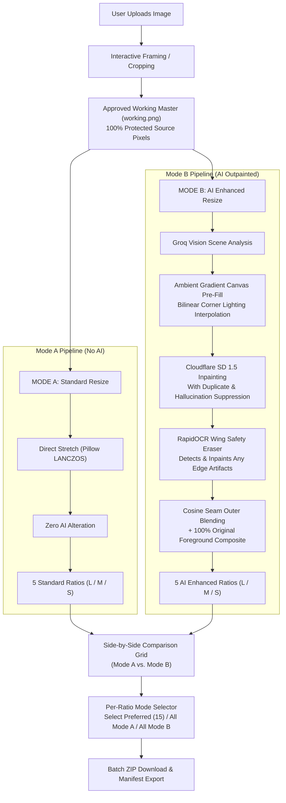

# Ratio Studio — Professional Multi-Ratio Image Converter

**Ratio Studio** is a modern, high-performance web application designed to automatically convert single source images into five standardized commercial aspect ratios without stretching distortion, blur, or artificial hallucinations.

It features two distinct processing modes:
- **Mode A — Standard Resize**: Pure mathematical Pillow LANCZOS direct stretch, preserving 100% of approved pixels with zero AI alteration.
- **Mode B — AI Enhanced Resize**: Cloudflare Workers AI generative outpainting background expansion with strict original-foreground protection, ambient lighting gradient pre-fill, dynamic subject-duplicate suppression, and automated RapidOCR text erasing.

---

## 🏗️ Architecture & Processing Workflow



---

## 📸 Five Commercial Target Ratios & Output Sizes

Every output is generated in three standard production scales (**Large**, **Medium**, and **Small**):

| Ratio | Orientation | Large (Base) | Medium | Small | Mode A (Standard) | Mode B (AI Enhanced) |
|---|---|---|---|---|---|---|
| **Square (1:1)** | Square | `2048 × 2048` px | `1024 × 1024` px | `512 × 512` px | Direct Stretch (LANCZOS) | AI Outpainted + Original Foreground |
| **Portrait (4:5)** | Portrait | `1600 × 2000` px | `1080 × 1350` px | `800 × 1000` px | Direct Stretch (LANCZOS) | AI Outpainted + Original Foreground |
| **Portrait (3:4)** | Portrait | `1536 × 2048` px | `1080 × 1440` px | `768 × 1024` px | Direct Stretch (LANCZOS) | AI Outpainted + Original Foreground |
| **Landscape (16:9)** | Landscape | `2560 × 1440` px | `1920 × 1080` px | `1280 × 720` px | Direct Stretch (LANCZOS) | AI Outpainted + Original Foreground |
| **Landscape (5:4)** | Landscape | `2000 × 1600` px | `1350 × 1080` px | `1000 × 800` px | Direct Stretch (LANCZOS) | AI Outpainted + Original Foreground |

---

## ⚡ Core Features & Innovations

### 1. Mode A vs. Mode B Side-by-Side Comparison
- Side-by-side interactive comparison for all five commercial aspect ratios.
- Flexible preference toggles per ratio (`Mode A` or `Mode B`).
- One-click batch selection shortcuts: **Select Preferred (15)**, **All Mode A (15)**, **All Mode B (15)**, or custom combinations.
- Single-click streaming ZIP export (`/api/download-selected`) with comprehensive `manifest.json`.

### 2. Strict Original Foreground Protection
- Customer-approved product details, logos, printed text, apparel graphics, and facial features remain **100% bit-for-bit identical** to the source crop.
- The generative AI model is strictly restricted to inpainting the surrounding outer background canvas.
- Smooth anti-aliased cosine outer seam blending prevents harsh rectangular edge artifacts.

### 3. Ambient Lighting Pre-Fill (Zero Duplicate Object Hallucinations)
- Replaces legacy edge-replication (`BORDER_REPLICATE`) with a **smooth 2D bilinear ambient lighting gradient** sampled from four image corners and Groq Vision scene analysis.
- Eliminates subject edge-smearing: no sliced shoe soles, wheels, or fabric strips are projected into outer wings.
- Front-loaded negative prompt dynamically suppresses duplicate subjects, footwear, vehicles, extra limbs, and mountains in studio shots.

### 4. Post-Generation RapidOCR Safety Guard
- High-speed ONNX-runtime OCR scans newly generated outer wings.
- Any hallucinated random letters, fake watermarks, or stock codes appearing in outer wings are automatically masked and seamlessly inpainted away using Telea diffusion before delivery.

### 5. AI Token Quota & Consumption Tracking
- Real-time token consumption tracking for Groq Vision analysis sessions.
- Interactive token balance header badge with dropdown metrics (tokens reduced, remaining quota, percentage left, reset capability).
- Detailed per-session audit card showing prompt tokens, completion tokens, and quota remainder.

---

## 🛠️ Technology Stack

### Frontend
- **React 19** with **TypeScript**
- **Vite 8**
- **Tailwind CSS v4** (Modern light theme with violet/purple Mode A & Mode B accents)
- **Lucide React** icons
- **Axios** with automatic backend proxying

### Backend
- **Python 3.11+**
- **FastAPI** & **Uvicorn**
- **Pillow** (LANCZOS resampling, sRGB color spaces, EXIF orientation correction)
- **OpenCV** (Atmospheric seam diffusion, bilinear color interpolation, Telea inpainting)
- **RapidOCR ONNX Runtime** (Anti-watermark wing scanner)
- **Cloudflare Workers AI** (`@cf/runwayml/stable-diffusion-v1-5-inpainting`)
- **Groq Vision SDK** (Scene understanding & extension guidance)

---

## 🚀 Quick Launch

### 1. Prerequisites
- **Python 3.11+** installed and available in PATH
- **Node.js 18+** and **npm**

### 2. Run with One Click
From the project root directory, run:
```powershell
./run.bat
```
This automatically launches both services:
- **Frontend**: `http://localhost:5173`
- **Backend API**: `http://127.0.0.1:8000` (Interactive Swagger Docs at `http://127.0.0.1:8000/docs`)

---

## 🧪 Testing

Run backend tests:
```powershell
pytest backend/tests/test_upload.py -v
```

Build and typecheck frontend:
```powershell
cd frontend
npm run build
```
